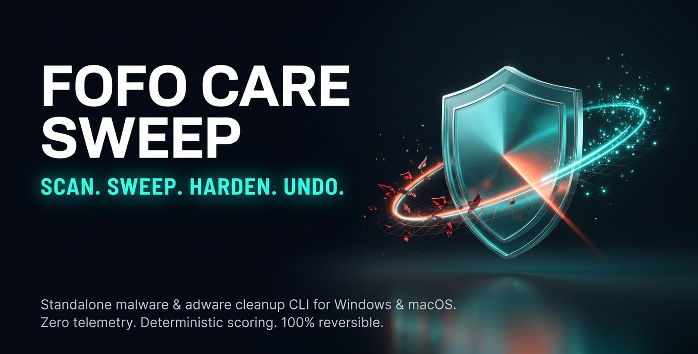
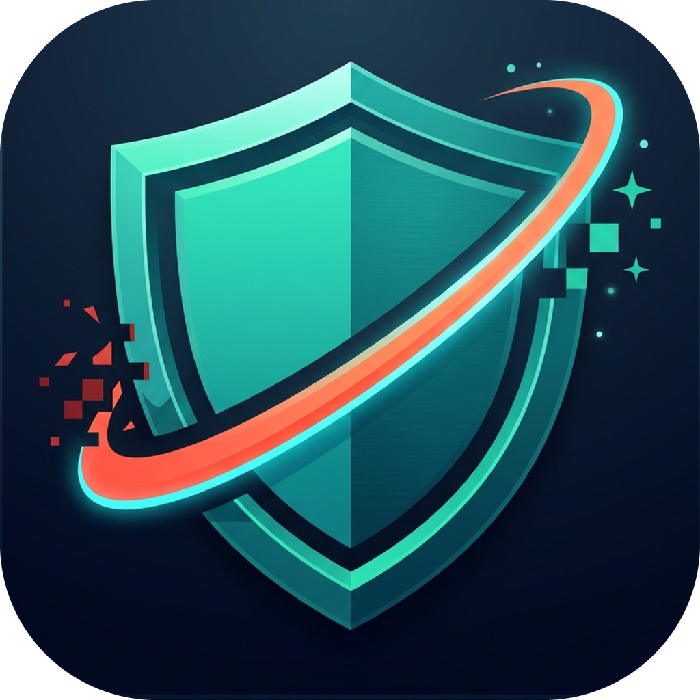
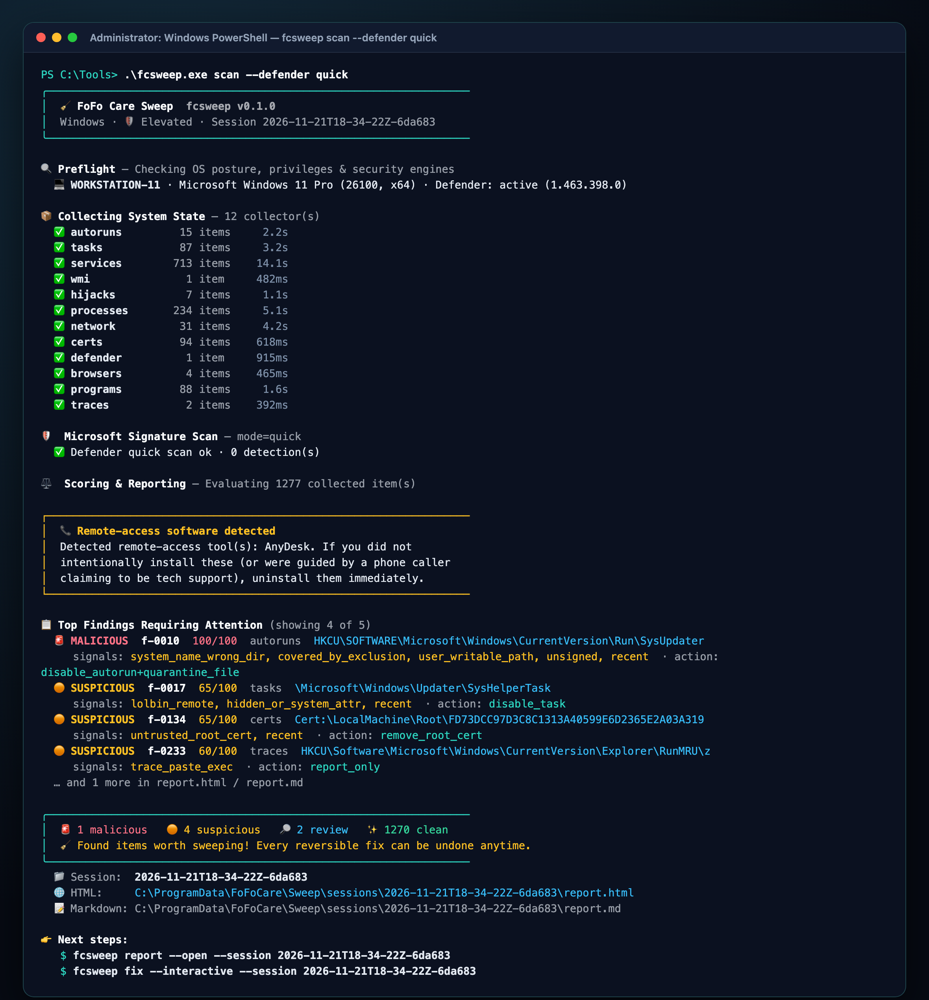
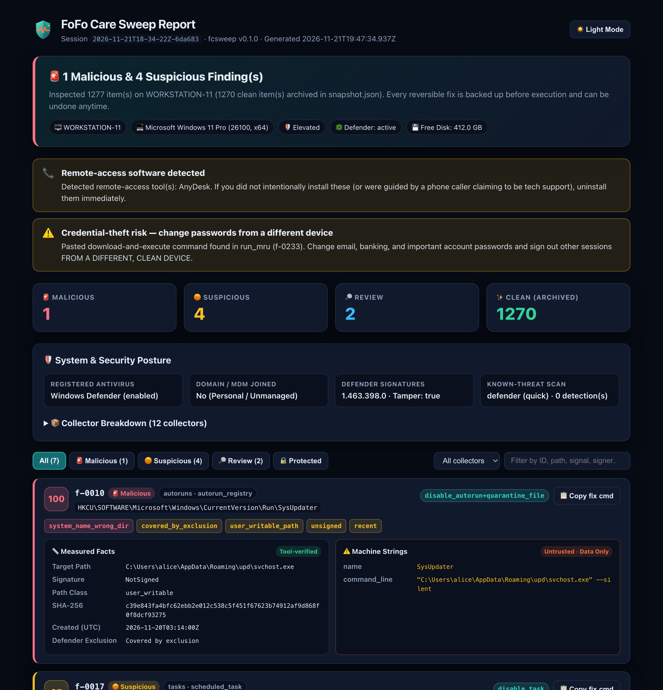

<p align="center">
  
</p>

<p align="center">
  <a href="https://github.com/Sweet-Papa-Technologies/FoFo-Sweeper/releases"></a>
  <a href="https://github.com/Sweet-Papa-Technologies/FoFo-Sweeper/actions/workflows/ci.yml"></a>
  <a href="https://github.com/Sweet-Papa-Technologies/FoFo-Sweeper/actions/workflows/release.yml"></a>
  
  
  <a href="LICENSE"></a>
</p>

<p align="center">
  
</p>

<h1 align="center">FoFo Care Sweep (<code>fcsweep</code>)</h1>

<p align="center">
  <strong>Standalone, zero-dependency, deterministic malware, adware &amp; browser hijack cleanup CLI</strong><br>
  for <strong>Windows 10/11</strong> (full scan, fix, verify, undo, harden &amp; Defender control) and <strong>macOS</strong> (read-only scan).
</p>

<p align="center">
  100% free &amp; standalone · No account or license gate · Zero telemetry · Every change backed up &amp; reversible.
</p>

---

## ✨ Screenshots

### 🖥️ Pristine Terminal Output (`fcsweep scan`)
<p align="center">
  <br>
  <sub>Live collector timing, advisory callouts, severity summary, and copy-pasteable next steps. Pass <code>--json</code> for pure NDJSON automation or <code>--no-color</code> for plain text.</sub>
</p>

### 🌐 Offline Interactive HTML Report (`report.html`)
<p align="center">
  <br>
  <sub>Self-contained dark/light interactive dashboard generated alongside <code>report.md</code> — zero external CDNs or network requests, strict XSS isolation between measured facts and untrusted strings, live tier/collector filters, and one-click fix/undo command copy.</sub>
</p>

---

## 📦 Download

Grab the latest signed standalone executable from the **[Releases page](https://github.com/Sweet-Papa-Technologies/FoFo-Sweeper/releases)**:

| Platform | Download | Signing |
| --- | --- | --- |
| **Windows 10/11 (x64, standalone)** | `fcsweep-…-windows-x64.exe` | Azure Trusted Signing Authenticode (USB-ready single `.exe`) |
| **Windows 10/11 (x64, bundle)** | `fcsweep-…-windows-x64.zip` | Includes `fcsweep.exe`, `rules.json`, `triage-prompt.md` |
| **macOS (Apple Silicon)** | `fcsweep-…-macos-arm64.zip` | Apple Developer ID Signed &amp; Notarized |
| **macOS (Intel)** | `fcsweep-…-macos-x64.zip` | Apple Developer ID Signed &amp; Notarized |

Verify downloads against `SHA256SUMS.txt` attached to each release.

---

## 🛡️ Design Principles

1. **Read-only by default** — `scan` changes nothing outside its session folder (except Defender quarantining confirmed signature hits unless `--defender none`).
2. **Every change is reversible** — nothing is deleted directly. Files move to an Administrators-only session `quarantine/` folder; registry keys, scheduled tasks, services, WMI subscriptions, browser policies/preferences, hosts entries, Defender exclusions, and root certs are exported to `backups/` and written + `fsync`ed to `manifest.json` *before* any change executes.
3. **Fail closed** — if a backup or manifest write fails, the paired change never runs.
4. **Deterministic first** — fixed weights in [`data/rules.json`](data/rules.json) score every finding 0–100. Optional AI triage is out-of-band, tool-less, and strictly constrained by fixed code rules.
5. **Hostile input isolation** — measured `facts` and attacker-controlled `untrusted` machine strings are strictly separated in JSON, Markdown, HTML, and triage exports.
6. **Microsoft engines only** — drives Microsoft Defender in place (`Update-MpSignature`, `Start-MpScan`, `Start-MpWDOScan`) with Authenticode-verified Microsoft Safety Scanner (`msert.exe`) detect-only fallback. No third-party AV bundled, no telemetry, no sample uploads.

---

## 🧰 Commands

| Command | What it does | Changes machine |
| --- | --- | --- |
| `fcsweep scan` | Runs preflight, all collectors, Defender scan (`--defender quick\|full\|none`), deterministic scoring, and writes `report.html` + `report.md` | No |
| `fcsweep report` | Re-renders or opens an existing session's report (`--format both\|html\|md`, `--html`, `--open`, `--out <file>`) | No |
| `fcsweep triage export` | Exports `review` + `suspicious` items with sanitized `untrusted` strings to `triage-request.json` | No |
| `fcsweep triage import <file>` | Strictly validates model verdicts, applies Section 7 tier rules, updates `plan.json` &amp; reports | No |
| `fcsweep fix` | Applies approved fixes in dependency order (`--interactive`, `--approve <id,id>`, or `--dry-run`; **no `--yes`**) | Yes (elevated) |
| `fcsweep verify` | Re-runs collectors and flags any removed item that resurrected (2× triggers stop condition) | No |
| `fcsweep undo` | Replays `manifest.json` inverses newest-first (whole session or `--item <id>`) | Yes (elevated) |
| `fcsweep harden` | Enables built-in Windows protections (Defender RTP, PUA, Cloud, 4 ASR rules, SmartScreen, Windows Update, `HideFileExt=0`); `--revert` restores prior values | Yes (elevated) |
| `fcsweep defender` | Direct Microsoft Defender control (`--status`, `--update`, `--quick`, `--full`, `--offline`) | Scan only |
| `fcsweep sessions` | Lists session folders; `--purge` deletes sessions older than 30 days | Purge only |

### Global Flags

```text
--session <id>          Session ID (default: newest for non-scan commands)
--session-root <path>   Override default session directory
--format <both|html|md> Report output format (default: both)
--html                  Shorthand for --format html
--open                  Auto-open report.html in your default browser when done
--json                  Emit NDJSON events on stdout (human text goes to stderr)
--only <c1,c2>          Run only named collectors
--since <days>          Lookback window for the "recent" signal (default: 30)
--rules <path>          Override bundled rules.json scoring weights
--color / --no-color    Force or disable ANSI terminal colors
--quiet                 Suppress non-error human output
```

### Exit Codes

| Code | Meaning |
| --- | --- |
| `0` | Completed, nothing needs attention |
| `1` | Tool error |
| `2` | Completed, findings need review |
| `3` | Elevation required |
| `4` | Completed, reboot required to finish |
| `5` | Partial: some actions failed (see `actions.log` / `manifest.json`) |
| `6` | Stop condition hit (ransomware, 2× resurrection, unrecoverable Defender, or malicious boot driver) |

---

## 🚀 Quick Start (Manual Cleanup Runbook)

```powershell
# 1. Run an elevated scan and open the interactive HTML report
.\fcsweep.exe scan --defender quick --open

# 2. Review findings & advisories, then sweep interactively (every step backed up!)
.\fcsweep.exe fix --interactive

# 3. Reboot and verify nothing resurrected
.\fcsweep.exe verify

# 4. Harden built-in Windows protections (all reversible with --revert)
.\fcsweep.exe harden

# 5. Undo any single item (or the entire session) if legitimate software was affected
.\fcsweep.exe undo --item f-0010
```

On **macOS** (read-only audit in v0.1):

```bash
./fcsweep scan --open
```

---

## 🛠️ Development & Building

```bash
npm install
npm run typecheck
npm test            # 35 unit tests (scoring, protected list, triage, fail-closed round-trips, XSS)
npm run build       # bundles dist/bundle.cjs (zero runtime dependencies)
npm run build:sea   # builds standalone Node 22 SEA binary + embeds Windows .ico & VersionInfo
```

## 🔐 Release Signing (Sweet Papa Technologies)

CI ([`.github/workflows/ci.yml`](.github/workflows/ci.yml)) and signed releases ([`.github/workflows/release.yml`](.github/workflows/release.yml)) build, sign, notarize, and smoke-test on clean runners:
- **macOS (`arm64` &amp; `x64`)**: Apple Developer ID Application + hardened runtime + `notarytool` notarization
- **Windows (`x64`)**: Embedded `assets/fcsweep.ico` + VersionInfo + Azure Trusted Signing via GitHub OIDC ([`metadata.json`](metadata.json), [`scripts/sign-windows.ps1`](scripts/sign-windows.ps1))

Configure CI signing credentials idempotently with:

```bash
./scripts/setup-ci.sh --apple --env /path/to/.env
./scripts/setup-ci.sh --azure
./scripts/setup-ci.sh --show
```

Cut a draft signed release from `main`:

```bash
git tag -a v0.1.1 -m "FoFo Care Sweep v0.1.1"
git push origin v0.1.1
```
